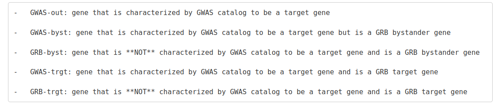

# Description

Data exploration based on byGRB object

# Libraries

```{r Libraries, message=FALSE}
library(dplyr)
library(stringr)
library(tibble)
library(ggplot2)
```

# Load data

Starting from by_GRB_list. Elements in the list are GRBs named by their
genomic range. !!! Do not try to view the whole list since it has no
print limit and will crash R.!!! Each GRB element contains four other
elements:

1.  DF of genes inside the GRB with ensembl and hgnc ids. Also each gene
    is categorized as one of the following:

    

2.  DF where rownames are enhancer regions and columns are transcripts.
    Values in the df represent **correlation** between expression levels
    from the cage experiment. It contains values from -1 to 1. (t*his
    dataframe will not be used since it is not informational - Anja
    mail*)

3.  DF with rownames as enhancer regions and columns are transcripts.
    Values
    in the df contain values of the permutation test. The description of
    the test in my (physical) notebook. It contains values from 0 to 1.

```{r}
# by_GRB_list provided by Anja - mail
by_GRB_list <- readRDS ("data/targPred_byGRB_list_wEnhancers_GeThesisTargets_FANTOM5.rds")

# Master with ranges, Provided by Filip - mail
master_ranges <- readRDS(file = "data/enh_trans_ranges.rds")

# Target genes
trg_genes <- read.table("data/hg19.canFam3.tsv", header = T)

```

Globals
```{r}
GRB_CAT_COLORS <- c("GRB-byst" ="#143159", 
                    "GRB-trgt" = "#4E7DD9",
                    "GWAS-byst" = "#D9A60D",
                    "GWAS-out" = "#275912",
                    "GWAS-trgt" = "#DA3426")
```


# Master table
```{r}
# Master table adress
filename <- "data/by_GRB_list_MASTER.rds"
file.exists(filename)
```

Here we build the master table from the by_GRB_list. This table will be
used to calculate features of enh gene pairs

This is a helper func

```{r}
namedVecToDf <- function(named_vector, column_name = "col1"){
  df <- as.data.frame(named_vector) %>%

    dplyr::select({{column_name}} := Var1, Freq)
  return(df)
}
```

A master table is built in a way that a combination of
gene:transcript id and an enhancer range is the key (unique
combination). Every such pair has an empirical p value calculated via
permutation test. Other columns derived from the by_GRB_list are:

-   **grb:** range of the GRB which span the genes and enhancers

-   **ensembl:** gene ensembl id, there may be multiple transcripts per
    gene

-   **symbol:** hgnc gene symbol

-   **category:** gene category which depends whether it is mapped by
    the GWAS catalog and by the GRB hypothesis

Additional features:

-   **enh_num_4gene:** number of enhancers that regulate that gene

-   **gene_num_4enh:** number of genes that are under regulation by that
    enhancer.

Looping through all grb's in the by_GRB_list to fetch all df.


```{r, eval=FALSE}
master <- data.frame()
empty_grbs <- c()
for(i in 1:length(by_GRB_list)){
  message(paste(i,". Binding the grb: ",names(by_GRB_list)[i], sep = ""))
  working_el <- by_GRB_list[[i]]
  
  if(setequal(dim(by_GRB_list[[i]][[3]]) ,c(0,0))){
    message(paste(i,". does not have enhancers", sep=""))
    empty_grbs <- append(empty_grbs, names(by_GRB_list)[i])
    next
  }
  
  # Df for the ith grb
  working_df <- 
  data.frame(
    # Adding GRB coordinates
    grb = names(by_GRB_list)[i],
    # This column contains gene id, transcript id and enhancer from df3
    gene_trans_enh = c(outer(colnames(working_el[[3]]),rownames(working_el[[3]]), FUN=paste, sep="_")),
    
    # Unrolling emp values in a vector and adding them to the master
    emp = as.vector(t(as.matrix(working_el[[3]])))
    ) %>%
    
    # Splitting gene:transcript ids and enhancer location
    dplyr::mutate(gene_trans=str_split(gene_trans_enh, pattern="_", simplify=TRUE)[,1],
           enh=str_split(gene_trans_enh, pattern="_", simplify=TRUE)[,2]) %>%
      
    # Splitting gene and transcript ids - ensembl gene id
    dplyr:: mutate(ensembl=str_split(gene_trans, pattern=":", simplify=TRUE)[,1]) %>%
      
    # Splitting gene and transcript ids - ensembl transcript id
    dplyr::mutate(transcript=str_split(gene_trans, pattern=":", simplify=TRUE)[,2]) %>%
      
    # Adding gene symbol and category
    left_join(working_el[[1]], by=c("ensembl"="ens")) %>%
    
    # Removing the extra column
    dplyr::select(-gene_trans_enh)
  
  if(any(working_df$emp < 0.001)){
  

    working_df <- working_df %>%
    # Adding per enhancer number of genes that it regulates (emp < 0.001)
      left_join(as.data.frame(base::table(filter(working_df, emp < 0.001)$enh)), 
                by = c("enh" = "Var1")) %>%
    dplyr::rename(gene_num_4enh=Freq) %>%
    
    # Adding per gene number of enh that are regulated by (emp < 0.001)
    left_join(as.data.frame(base::table(filter(working_df, emp < 0.001)$transcript)), 
              by = c("transcript" = "Var1")) %>%
    dplyr::rename(enh_num_4gene=Freq)
    
  }
  else{
    working_df$gene_num_4enh <- NA
    working_df$enh_num_4gene <- NA
  }
  
  
    
  # Apending rows to master
  master <- rbind(master, working_df)
  
}

# Adding ranges from R object - provided by Filip
master <- master %>%
  left_join(master_ranges, by = c("enh","transcript"))

rm(master_ranges)
  

saveRDS(master, "data/by_GRB_list_MASTER.rds")
```


```{r}
master <- readRDS(filename)
```

## Histograms
Histogram of number of genes associated per enhancer
```{r}
master %>%
  select(enh, gene_num_4enh) %>%
  unique() %>%
  pull(gene_num_4enh) %>%
  hist(breaks = 50, xlim=c(1,20), col="yellow")
```
Histogram of enhancers associated per one transcript
```{r}
master %>%
  select(transcript, enh_num_4gene) %>%
  unique() %>%
  pull(enh_num_4gene) %>%
  hist(breaks=50, xlim=c(0,20), col="darkred")
```
## Boxplots
Genes are sorted in 5 bins by categories. Each gene (transcript) has an number of enhancers that they are associated with. In this boxplot we compare by category how many enhancers are assigned to each bin.
### master_transcript
```{r}
# Subsetting unique transcripts
master_transcript <- master %>%
  filter(emp < 0.001) %>%
  select(grb,ensembl,symbols=symbol,category,enh_num_4gene) %>%
  unique()


ggplot(master_transcript, aes(x=category, y=enh_num_4gene, fill=category)) +
  geom_boxplot()+
  theme_minimal() +
  scale_fill_manual(values = GRB_CAT_COLORS)

ggplot(master_transcript, aes(x=category, y=enh_num_4gene, fill=category)) +
  geom_violin()+
  coord_cartesian(ylim = c(0,20))+ 
  theme_minimal() +
  scale_fill_manual(values = GRB_CAT_COLORS)
```
Box plots
```{r}
master_transcript <- master_transcript %>%
  dplyr::mutate(target_gene =
                  case_when(is.element(symbols,trg_genes$geneName) ~ "Yes",
                            !is.element(symbols,trg_genes$geneName) ~ "No"))


ggplot(master_transcript, aes(x=target_gene, y=enh_num_4gene, fill = target_gene)) +
  geom_boxplot() +
  coord_cartesian(ylim = c(0,20))+ 
  scale_fill_manual(values = c("black", "darkred")) +
  theme_minimal()+ 
  stat_summary(fun = "median", geom = "crossbar", color = "yellow", size = 0.4, show.legend = FALSE)+
  stat_summary(fun = "mean", geom = "crossbar", color = "gray", size = 0.4, show.legend = FALSE)
```


### master_genes
The next chunk is similar, only with genes. Selecting the gene with the most number of enhancers
```{r}
# Subsetting unique genes
master_genes <- master %>%
  filter(emp < 0.001) %>%
  unique() %>%
  group_by(ensembl) %>%
  summarise(enh_num_4gene = max(enh_num_4gene)) %>%
  ungroup() %>%
  # adding category info
  left_join(master %>% select(category, ensembl, symbols =symbol) %>% unique)


ggplot(master_genes, aes(x=category, y=enh_num_4gene, fill=category)) +
  geom_boxplot()+
  theme_minimal() +
  scale_fill_manual(values = GRB_CAT_COLORS)

ggplot(master_genes, aes(x=category, y=enh_num_4gene, fill=category)) +
  geom_violin()+
  coord_cartesian(ylim = c(0,20)) +
  scale_fill_manual(values = GRB_CAT_COLORS)+
  theme_minimal()
```

Separating enh numbers per genes for target and non target genes
```{r}
master_genes <- master_genes %>%
  dplyr::mutate(target_gene =
                  case_when(is.element(symbols,trg_genes$geneName) ~ "Yes",
                            !is.element(symbols,trg_genes$geneName) ~ "No"))

ggplot(master_genes, aes(x=target_gene, y=enh_num_4gene, fill = target_gene)) +
  geom_boxplot() +
  coord_cartesian(ylim = c(0,20))+ 
  scale_fill_manual(values = c("black", "darkred")) +
  theme_minimal()+ 
  stat_summary(fun = "median", geom = "crossbar", color = "yellow", size = 0.4, show.legend = FALSE)+
  stat_summary(fun = "mean", geom = "crossbar", color = "gray", size = 0.4, show.legend = FALSE)
```

### t test
```{r}

x = dplyr::filter(master_genes, target_gene == "No")$enh_num_4gene
y = filter(master_genes, target_gene == "Yes")$enh_num_4gene
print(t.test(x,y))
```
### emp value violin plots
This is the same plot ANja provided for whole GWAS
```{r}
ggplot(master, aes(x=category, y=emp, fill=category)) +
  scale_fill_manual(values = GRB_CAT_COLORS)+
  theme_minimal()+
  stat_ydensity() +
  stat_summary(fun = "mean", geom = "crossbar", color = "black", size = 0.4, show.legend = FALSE)

table(master$category)
```


# Genomic distance
Distribution of distance of signif. transcript - enh associations
```{r}
hist(log(filter(master, emp <= 0.001)$enh_trans_range,10))
```


Binning gene-enhancer ranges.
```{r}
master <-
  master %>%
  dplyr::mutate(ranges_binned = case_when(
    enh_trans_range <= 1000 ~ "1-10^3",
    enh_trans_range > 1000 & enh_trans_range <= 10000 ~ "10^3-10^4",
    enh_trans_range > 10000 & enh_trans_range <= 100000 ~ "10^4-10^5",
    enh_trans_range > 100000 & enh_trans_range <= 1000000 ~ "10^5-10^6",
    enh_trans_range > 1000000 ~ "10^6-"))
```
Histogram of all genomic distance between gene transcripts and enhancers
```{r}
ggplot(master, aes(x=enh_trans_range)) +
  geom_histogram()+
  theme_minimal()+
  coord_cartesian(ylim=c(0,7500))+
  facet_wrap(~ranges_binned, scales = "free_x")+
  ggtitle("Histograms of genomic distances in 4 bins - 10^(3,4,5,6)")
```
Histogram of all genomic ranges between gene transcripts and enhancers with interactions significance lvl 0.001
```{r}
ggplot(filter(master, emp < 0.001), aes(x=enh_trans_range)) +
  geom_histogram(bins = 100)+
  theme_minimal()+
  coord_cartesian(ylim = c(0,100))+
  facet_wrap(~ranges_binned, scales = "free_x")+
  ggtitle("Histograms of singificant genomic distances in 4 bins - 10^(3,4,5,6)")
```

## Cumulative plots
Cumulative frequency of enhancer-transcript distances
```{r}
# All
plot(ecdf(log(master$enh_trans_range, 10)))
```


```{r}
# Significant enhancer-transcript associations
plot(ecdf(log(filter(master, emp < 0.001)$enh_trans_range,10)))
```
## Genomic distance by category
Histogram of distance distribution by category
```{r}
ggplot(filter(master, emp < 0.001), aes(x=log(enh_trans_range,10)))+
  geom_histogram(bins = 50)+
  #coord_cartesian(ylim = c(0,200))+
  facet_wrap(~category, scales = "free")
```
Cumulative plot of distances
```{r}
ggplot(filter(master, emp < 0.001), aes(x=log(enh_trans_range,10)))+
  geom_histogram(aes(y=cumsum(..count..)), bins = 50)+
  facet_wrap(~category, scales = "free")
```
# Counting enhancer - promoter (EP) pair per category and distance bin

Here we count enhancers that regulate a gene selecting only those with p value < 0.001 (or some other).
From the master df that contains values of each enh-gene emp values we first separate them by ranges as defined above. Then, per range bin we count how many enhancers regulate a gene(transcript). To visualize that we separate genes by category status they have in GRB. As explained above.

```{r}
# Counts per EP distance bin number of singf. EP pairs
EP_pair_count <- 
  master %>%
  filter(emp < 0.001) %>%
  group_by(transcript, ranges_binned) %>%
  count(transcript) %>%
  select(enh_num_4gene_binned = n, everything())

master <- left_join(master, EP_pair_count)
```
## Plotting binned categories 
```{r}
ggplot(filter(master, emp < 0.001) %>% 
         select(transcript, category, enh_num_4gene_binned, ranges_binned) %>% 
         unique(),
       aes(x=category, y=enh_num_4gene_binned, fill=category)) +
  geom_violin(draw_quantiles = c(0.5))+
  theme_minimal()+
  theme(axis.text.x=element_blank())+
  coord_cartesian(ylim = c(0,5))+
  facet_wrap(~ranges_binned, scales = "free", nrow = 2, ncol = 3)+
  ggtitle("Number of enhancers per gene by category")+
  #geom_text(data = master, aes(x=category, y = 0))+
  stat_summary(fun = "median", geom = "crossbar", color = "darkblue", size = 0.4, show.legend = FALSE)+
  stat_summary(fun = "mean", geom = "crossbar", color = "black", size = 0.4, show.legend = FALSE)+
  # Adding colors to categories
  scale_fill_manual(values = GRB_CAT_COLORS)
```

```{r}
# Subseting master to get unique combinations 
master_sub <- filter(master, emp < 0.001) %>% 
         select(transcript, category, enh_num_4gene_binned, ranges_binned, target_gene) %>% 
         unique()
  
ggplot(master_sub, aes(x=target_gene, y=enh_num_4gene_binned,fill=target_gene))+
  geom_boxplot() +
  theme_minimal()+
  facet_wrap(~ranges_binned, scales = "free", nrow = 2, ncol = 3)+
  coord_cartesian(ylim = c(0,10))+
  scale_fill_manual(values = c("black", "darkred"))+
  stat_summary(fun = "median", geom = "crossbar", color = "yellow", size = 0.4, show.legend = FALSE)+
  stat_summary(fun = "mean", geom = "crossbar", color = "gray", size = 0.4, show.legend = FALSE)
```
### t test 
```{r}
for(i in master$ranges_binned %>% unique() %>% sort){
  x = filter(master_sub, ranges_binned == i & target_gene == "No")$enh_num_4gene_binned
  y = filter(master_sub, ranges_binned == i & target_gene == "Yes")$enh_num_4gene_binned
  print(paste("Interval", i))
  print(t.test(x,y))
}
```
## Cumulative binned categories
Summing up EP pairs per distance bins
```{r}

# Adding target gene flag
master <- master %>%     
  mutate(target_gene =case_when(is.element(ensembl,trg_genes$ENSEMBLGeneID) ~ "Yes",
                                !is.element(ensembl,trg_genes$ENSEMBLGeneID) ~ "No"))

EP_pair_count <- 
  master %>%
  filter(emp < 0.001) %>%
  select(transcript, ranges_binned, enh_num_4gene_binned) %>%
  unique() %>% 
  arrange(ranges_binned)%>%
  group_by(transcript) %>%
  mutate("cm_enh_num_4gene" = cumsum(enh_num_4gene_binned))

master <- 
  left_join(master, EP_pair_count)

print("Example")
master %>%
  filter(emp < 0.001 & transcript =="ENST00000308873") %>%
  select(symbol, transcript, ranges_binned, enh_num_4gene_binned, cm_enh_num_4gene) %>%
  unique() %>%
  arrange(ranges_binned)
```
## ploting cumulative enhancers distance binned
```{r}
ggplot(filter(master, emp < 0.001) %>%
         select(transcript, ranges_binned, category, cm_enh_num_4gene)%>%
         unique(),
       aes(x=category, y=cm_enh_num_4gene, fill=category)) +
  geom_violin(draw_quantiles = c(0.5))+
  theme_minimal()+
  theme(axis.text.x=element_blank())+
  coord_cartesian(ylim = c(0,15))+
  facet_wrap(~ranges_binned, scales = "free", nrow = 2, ncol = 3)+
  ggtitle("Number of enhancers per gene by category")+
  #geom_text(data = master, aes(x=category, y = 0))+
  stat_summary(fun = "median", geom = "crossbar", color = "darkblue", size = 0.4, show.legend = FALSE)+
  stat_summary(fun = "mean", geom = "crossbar", color = "black", size = 0.4, show.legend = FALSE)+
  # Adding colors to categories
  scale_fill_manual(values = GRB_CAT_COLORS)
```
Target genes

```{r}
# Subseting for plots (use unique combinations not the master table which is full)
master_sub <- filter(master, emp < 0.001) %>%
         select(transcript, ranges_binned, target_gene, cm_enh_num_4gene) %>%
         unique()

ggplot(master_sub, aes(x=target_gene, y=cm_enh_num_4gene,fill=target_gene))+
  geom_boxplot() +
  theme_minimal()+
  facet_wrap(~ranges_binned, scales = "free", nrow = 2, ncol = 3)+
  coord_cartesian(ylim = c(0,15))+
  scale_fill_manual(values = c("black", "darkred"))+
  stat_summary(fun = "median", geom = "crossbar", color = "yellow", size = 0.4, show.legend = FALSE)+
  stat_summary(fun = "mean", geom = "crossbar", color = "gray", size = 0.4, show.legend = FALSE)
```

### ttest
```{r}
for(i in master$ranges_binned %>% unique() %>% sort){
  x = filter(master_sub, ranges_binned == i & target_gene == "No")$cm_enh_num_4gene
  y = filter(master_sub, ranges_binned == i & target_gene == "Yes")$cm_enh_num_4gene
  print(paste("Interval", i))
  print(t.test(x,y))
}
```

# Session Info

```{r Session info}
sessionInfo()
```
