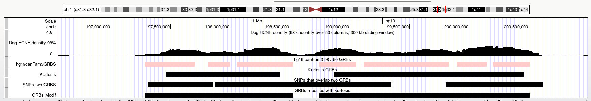

# Description

In this notebook each SNP from the GWAS catalog is assigned to a GRB.
Individual SNPs are not considered but their respective LD block.

# Libraries


```{r Libraries, message=FALSE}
library(GenomicRanges)
library(rtracklayer)
library(purrr)
library(curl)
library(RColorBrewer)
library(org.Hs.eg.db)
library(Gviz)
library(BSgenome.Hsapiens.UCSC.hg19)
library(SNPlocs.Hsapiens.dbSNP144.GRCh37)
library(tidyverse)

project_dir <- "/home/katarina/MyProjects/targPred"
inputs_dir <- "data/inputs"
processed_dir <- "data/processed"
outputs_dir <- "data/outputs"
# GWAS catalog in use
gwas_dir <- "gwas_catalog_2021"


# Utils based on Anjas functions : expression_matrix_cage_functions.R
source(file.path(project_dir, "src/scripts/utils.R"))
```

# Loading data

GWAS data were downloaded and processed by LD_Block_Calculation package.
- Data downloaded from /pub/databases/gwas/releases/2021/07/12 with
ontology annotated data - Studies that contain european ancestry where
selected - For each SNP an LD block was calculated with R2>0.6 on an
Grch37 assembly

Since GWAS data are annotated on Grch38 assembly, chromosome region and
position will be removed. LD blocks are Grch37 assembly. Only relevant
columns will be selected, other data can be obtained relationaly from
the original gwas_association, gwas_ancestry or gwas_study data.

GRBs are stored on github and downloaded locally ## Downloading GRBs
Threshold data, GRBs and target genes where provided to me via mail. All
necessary files are stored on github repo. All are first downloaded,
then loaded in the next chunk


```{r, eval=FALSE}
url3<- "https://raw.githubusercontent.com/PKatarina/GRB/main/GRB_thresholds_beds/hg19.canFam3.98.50.processed.threshold.grbs.bed"

download.file(url3, destfile = "data/hg19.canFam3.98.50.processed.threshold.grbs.bed")

url4 <- "https://raw.githubusercontent.com/PKatarina/GRB/main/target_genes/hg19.canFam3.tsv"

download.file(url4, destfile = "data/hg19.canFam3.tsv")

url5 <- "https://raw.githubusercontent.com/alexander-nash/kurtosis_conservation/master/Data/binned_quantile_kurtosis_genome_ave_grbs/hg19_canFam3_binned_kurtosis_arl_370_0.7_pc_30_kb_windows_grbs.bed"

download.file(url5, destfile = "data/hg19_canFam3_binned_kurtosis_arl_370_0.7_pc_30_kb_windows_grbs.bed")

url6 <- "https://fantom.gsc.riken.jp/5/datafiles/latest/extra/Enhancers/human_permissive_enhancers_phase_1_and_2_expression_tpm_matrix.txt.gz"


download.file(url6, destfile = "data/human_permissive_enhancers_phase_1_and_2_expression_tpm_matrix.txt.gz")

```

# ```{bash, eval = FALSE}
# gunzip data/human_permissive_enhancers_phase_1_and_2_expression_tpm_matrix.txt.gz
# ```

```{r}
# Filips SNP, check if they match up?
gwas <- readRDS(file.path(project_dir, "data/processed/granges_full.rds")) %>%
  dplyr::select(CHR= "chromosome", SNPS = "query_snp", LDblock = "LDblock.0.6", STUDY.ACCESSION, REPORTED.GENE.S.,
         MAPPED_GENE, P.VALUE, MAPPED_TRAIT, MAPPED_TRAIT_URI) %>%
  filter(!is.na(CHR))


  # Selecting relevant columns
# Output from LD_Block_Calculation.Rmd 
# gwas <- readRDS("data/gwas_associations_LDblock.rds") %>%
#   select(CHR= "CHR_ID", SNPS, LDblock, STUDY.ACCESSION, REPORTED.GENE.S., 
#          MAPPED_GENE, P.VALUE, MAPPED_TRAIT, MAPPED_TRAIT_URI) %>%
#   filter(!is.na(CHR))


# Main GRB dataset
cne_density_grb <- 
  import.bed(file.path(project_dir,"data/inputs/hg19.canFam3.98.50.processed.threshold.grbs.bed")) %>%
  makeGRangesFromDataFrame() %>%
  # Reducing since some GRBs overlap
  # Look at CNE_density_overlapping_GRBs.txt for examples
  GenomicRanges::reduce()

start(cne_density_grb) = start(cne_density_grb) -1

# Target genes for CNE density GRBs 
target_genes <- 
  read.csv(file.path(project_dir,"data/inputs/hg19.canFam3.tsv"), sep = "\t", header = TRUE)

# Kurtosis based, used for modifying CNE GRBs
kurtosis_grb <- 
  rtracklayer::import.bed(file.path(project_dir,"data/inputs/hg19_canFam3_binned_kurtosis_arl_370_0.7_pc_30_kb_windows_grbs.bed"), genome = "hg19")
start(kurtosis_grb) = start(kurtosis_grb) -1


```

# Helper functions

```{r make granges from dataframe, eval=FALSE}

grangesFromDataframe <- function(data, colName, keep_metadata=TRUE){
  # Description: make granges from dataframe
  # which has a column of this format:
  # chr4:11394774-11431389

  data_r <-
    data %>%
    mutate(start=as.character(str_split(!!rlang::enquo(colName), pattern = ":|-", simplify = TRUE)[,2]),
           end=as.character(str_split(!!rlang::enquo(colName), pattern = ":|-", simplify = TRUE)[,3]),
           CHR= as.character(str_split(!!rlang::enquo(colName), pattern = ":|-", simplify = TRUE)[,1]))
  
  
  # Granges object is needed to detect SNP loci that overlap 2 GRBs
  data_r <-
    makeGRangesFromDataFrame(data_r,
                            seqnames.field ="chr",
                            start.field = "start",
                            end.field = "end",
                            keep.extra.columns = keep_metadata)


  return(data_r)
}
```

# Preprocessing gwas data

Gwas catalog stores the putative target gene of an SNP in two columns:
(from <https://www.ebi.ac.uk/gwas/docs/fileheaders> ) REPORTED GENE(S)*:
Gene(s) reported by author MAPPED GENE(S)*: Gene(s) mapped to the
strongest SNP. If the SNP is located within a gene, that gene is listed.
If the SNP is located within multiple genes, these genes are listed
separated by commas. If the SNP is intergenic, the upstream and
downstream genes are listed, separated by a hyphen. - Combine the two
columns in a single column GWAS_genes

-   transforming SNP LD blocks dataframe into gr object

```{r}
non_gene_names <- c("",NA,"intergenic","Intergenic", "NR")

gwas <- 
  gwas %>%
  # Creating a temporary column that contains all genes comma sep
  mutate(temp = case_when(is.element(REPORTED.GENE.S., non_gene_names) ~ MAPPED_GENE,
                                is.element(MAPPED_GENE, non_gene_names) ~ REPORTED.GENE.S.,
                                TRUE ~ str_c(REPORTED.GENE.S., MAPPED_GENE, sep = ", "))) %>%
  # Removing repeated genes (eg. SKIV2L, SKIV2L, SKIV2L, SKIV2L, SKIV2L, SKIV2L)
  mutate(GWAS_GENES = map_chr(str_split(temp, ", "), ~str_c(unique(.x),collapse = ", "))) %>%
  dplyr::select(-c(temp, REPORTED.GENE.S., MAPPED_GENE))


## gwas_gr stores SNP LD blocks in GenomicRanges object
gwas_gr <- grangesFromDataframe(gwas, LDblock)

```

# Modifying GRB intervals

In this chunk we modify CNE density GRBs based on kurtosis GRBs. The two
sets of GRBs are generated with two different methods of determining
GRBs. Since some GRBs boundaries are genomicaly close there are cases
where locus (LD block of a SNP) that may span in two GRBs, as in
example:



To do this, following steps were performed: - Adding target gene info to
grb genomic ranges - Selecting SNP LD blocks that span 2 (or more -
duplicated()) CNE based GRBs - Selecting those CNE based GRBs (those
that are spanned by one SNP LD block) - Selecting kurtosis based GRBs
that overlap those CNE based GRBs and *adding* them to the total data
frame of CNE based GRBs - Using the function *reduce* that results in
non overlapping GRBs

```{r}
# Overlapping all SNps to GRBs(After modification there should not be duplicated query hits)
ov_gwas_cne <-
  findOverlaps(query = gwas_gr, subject = cne_density_grb)

# Around 500 SNPs that overlap two GRBs
duplicated(queryHits(ov_gwas_cne)) %>% table()

# Storing overlap results in a dataframe and selecting only hits that correspond to SNP LD block that overlaps two GRBs
snps_two_grbs_index <- 
  as.data.frame(ov_gwas_cne) %>%
  filter(is.element(queryHits, queryHits(ov_gwas_cne)[duplicated(queryHits(ov_gwas_cne))]))

# Storing granges of SNPs that span two GRBs for visualization
snps_two_grbs <- gwas_gr[snps_two_grbs_index$queryHits,]

# Commenting out this so that every rerun does not overwrite
#export.bed(snps_two_grbs, "data/SNPs_two_GRBs.bed")

# Granges of GRBs for modification
#cne_density_grb_spanned <- cne_density_grb[snps_two_grbs_index$subjectHits,]

# Modifying CNE density GRBs with kurtosis GRBS
cne_density_grb_modf <-
  # First joining the original CNE density GRBs with
  c(cne_density_grb,
    # Kurtosis GRBs that overlap CNE GRBs that are spanned by SNP LD blocks
    subsetByOverlaps(kurtosis_grb, cne_density_grb[snps_two_grbs_index$subjectHits,])) %>%
  # Then reducing to keep the complete CNE + kurtosis GRB
  GenomicRanges::reduce()

## Storing for visualization
# Commenting out this so that every rerun does not overwrite
#export.bed(cne_density_grb_modf, "data/CNE_density_modf_kurtosis.bed")
# Storing RDS so that it keeps the right start (bed is 0 based)
#saveRDS(cne_density_grb_modf, "data/processed/GRBs_CNE_density_modf_kurtosis.rds")

rm(kurtosis_grb, cne_density_grb, snps_two_grbs, snps_two_grbs_index)
```

## Adding GRB target genes

Adding GRB target genes to each GRB - Making granges from dataframe -
Overlapping and left join to GRB to keep GRB intervals and adding
metadata - Multiple target genes may be assigned to a GRB from various
reasons, collapsing them into a by GRB row and comma separated

```{r}
# Building target gene genomic ranges
target_genes_gr <- grangesFromDataframe(target_genes,
                                        colName =ucscCoordinates.hg19)

# Adding target genes as metadata 
cne_density_grb_modf <- 
  plyranges::join_overlap_left(cne_density_grb_modf, target_genes_gr) %>%
  # Using dplyr to merge multiple targets in GRBs
  as.data.frame() %>%
  dplyr::group_by(start, end) %>%
  # Concatenating all these cols from metadata
  mutate(ENSEMBLGeneID = paste0(ENSEMBLGeneID, collapse = ", "),
         geneName = paste0(geneName, collapse = ", "),
         originalSupport = paste0(originalSupport, collapse = ", "),
         normalisedSupport = paste0(normalisedSupport, collapse = ", "),
         ucscCoordinates.hg19 = paste0(ucscCoordinates.hg19, collapse = ", ")) %>%
  unique()%>%
  ungroup() %>%
  makeGRangesFromDataFrame(keep.extra.columns = TRUE)

# saveRDS(cne_density_grb_modf, file = file.path(project_dir, processed_dir, "GRBs_CNE_density_modf_kurtosis.rds"))
```

# Loci in GRBs

*Anjas part* After preparing gwas_gr and cne_density_grb_modf subseting
those SNPs that are in GRBs and storing in loci_inGRB.gr.

```{r}
cne_density_grb_modf <- readRDS(file.path(project_dir, processed_dir, "GRBs_CNE_density_modf_kurtosis.rds"))
```


```{r}
loci_in_GRBs.gr <- subsetByOverlaps(gwas_gr, cne_density_grb_modf)
ovlp <- findOverlaps(loci_in_GRBs.gr, cne_density_grb_modf)

# Adding GRB coordinates to each locus as character
loci_in_GRBs.gr$grb.coords[queryHits(ovlp)] <-
  as.character(cne_density_grb_modf[subjectHits(ovlp)])
# Adding GRB target genes 
loci_in_GRBs.gr$GRB_GENES[queryHits(ovlp)] <- 
  cne_density_grb_modf[subjectHits(ovlp)]$geneName
```

Saving loci (LD blocks for SNPs) in bed format for visualizing in the
Genome Browser

```{r, eval=FALSE}
temp <-
  data.frame(seqnames=seqnames(loci_in_GRBs.gr),
  starts=start(loci_in_GRBs.gr)-1,
  ends=end(loci_in_GRBs.gr),
  names=c(rep(".", length(loci_in_GRBs.gr))),
  scores=c(rep(".", length(loci_in_GRBs.gr))),
  strands=strand(loci_in_GRBs.gr))

write.table(temp, file="data/loci_in_GRBs.bed", quote=F, sep="\t", row.names=F, col.names=F)

export.bed(loci_in_GRBs.gr, con = "data/loci_in_GRBs.bed")
```

# Separating Traits

Each investigated SNP has an associated mapped trait, or multiple. Since
our goal is to explore the relationship between a SNP and a single trait
row separation based on trait is required. Trait names are stored in
MAPPED_TRAIT and the URI that contain unique disease/trait ontology id
in MAPPED_TRAIT_URI. Traits are comma separated but some trait names
contain commas. To avoid error prone case by case exceptions, trait
separation will be based on the URI and trait names will be cross mapped
from the ontology. ! TODO: Consider using MONDO since there was an
update which uses MONDO IDs for existing traits insted of EFO so some
EFO ids are obsolete.

```{r}
# Transforming loci in GRB to dataframe
loci_in_GRBs.df <- mcols(loci_in_GRBs.gr) %>%
  as.data.frame()

trait_ontology <- dplyr::select(loci_in_GRBs.df, MAPPED_TRAIT_URI) %>%
  unique()
rownames(trait_ontology) <- NULL

trait_ontology <- 
  trait_ontology %>%
  # Separating multiple traits into rows
  tidyr::separate_rows(MAPPED_TRAIT_URI, sep = ",") %>%
  unique() %>%
  # Splitting the URI eg. http://www.ebi.ac.uk/efo/EFO_0007978 to select only the ID EFO_0007978
  mutate(EFO_ID = str_split(MAPPED_TRAIT_URI, pattern = "/", simplify = TRUE)[,5]) %>%
  filter(!is.na(MAPPED_TRAIT_URI))
```

## Downloading EFO ontology

Downloading all EFO terms and saving it locally since this chunk is
long.
(Now in script EfoOntology.R)
```{r,eval=FALSE}
efo_terms <- rols::terms("efo", pagesize = 10000)

saveRDS(efo_terms, file.path(project_dir, "data/inputs/EFO_terms.rds"))
```

Creating pairwise mappings of EFO ids with cross reference. *Do I need
this here?* 

```{r, eval=FALSE}
# Downloaded efo terms
efo_terms <- readRDS(file.path(project_dir, "data/inputs/EFO_terms.rds"))

# Initializing empty df
efo_mappings <- data.frame(id1=NA, id2=NA, label=NA) 

#cbind(efo_mappings, data.frame(id, unlist(efo_terms[[id]]@annotation$database_cross_reference), efo_terms[[id]]@label))

# Looping through elements of the list
for(i in 1:length(names(efo_terms@x))){
  id <- names(efo_terms@x)[i]
  if(i%%100 == 0) {message(i)}

    if(is.null(unlist(efo_terms[[id]]@annotation$database_cross_reference))){
      # Some ids have no cross refrences
      working_df <-  data.frame(id, NA, efo_terms[[id]]@label)
    }
  
  else{
  working_df <-  data.frame(id, unlist(efo_terms[[id]]@annotation$database_cross_reference), efo_terms[[id]]@label)
  }
  
  # Changing colnames of working_df before binding
  colnames(working_df) <- c("id1","id2","label")
  efo_mappings <- rbind(efo_mappings, working_df)
}

efo_mappings <- efo_mappings %>%
  # Removing a lot of duplicates
  unique() %>%
  # Removing first row that is only NA
  filter(!is.na(id1) & !is.na(id2) & !is.na(label))

write.csv(efo_mappings, file = "data/EFO_mappings.csv")
```

## Relabeling Traits

Example of the URI that has to be separated:
<http://www.ebi.ac.uk/efo/EFO_0004318>,
<http://www.ebi.ac.uk/efo/EFO_0007015>

```{r}
# Loading efo_terms
efo_terms <- readRDS(file.path(project_dir, inputs_dir, "EFO_terms.rds"))

loci_in_GRBs.df <-
  loci_in_GRBs.df %>%
  # Multiple URIs that correspond to one trait are sep with ","
  separate_rows(MAPPED_TRAIT_URI, sep = ",") %>%
  # Splitting URI slashes since the unique ID is stored in the end
  mutate(MAPPED_TRAIT_ID = str_split(MAPPED_TRAIT_URI, pattern = "/", simplify =TRUE)[,5]) %>%
  # Replacing underscore "_" with colon ":" since it is standard for ontology ids
  mutate(MAPPED_TRAIT_ID = str_replace_all(MAPPED_TRAIT_ID, "_",":")) 


for(id in 1:dim(loci_in_GRBs.df)[1]){
  
  term_id <- loci_in_GRBs.df$MAPPED_TRAIT_ID[id]
  # efo_terms is an ontology object which needs the termLabel method to access label
  tryCatch(loci_in_GRBs.df$MAPPED_TRAIT[id] <- rols::termLabel(efo_terms[term_id]),
           error=function(e){cat("ERROR :",conditionMessage(e), "\n")})
  
}

# Removing the obsolete_ addition from some trait labels
loci_in_GRBs.df <- 
  loci_in_GRBs.df %>%
  mutate(MAPPED_TRAIT = ifelse(str_detect(MAPPED_TRAIT,"obsolete_"),
                               str_remove(MAPPED_TRAIT, "obsolete_"), 
                               MAPPED_TRAIT)) %>%
  # Removing NA MAPPED_TRAIT
  filter(!is.na(MAPPED_TRAIT))
  

# Save as outputs table
# write.csv(loci_in_GRBs.df, file = file.path(project_dir, outputs_dir, "loci_in_GRBs.df.csv"))
# Save the rds object to processed
# saveRDS(loci_in_GRBs.df, file = file.path(project_dir, processed_dir, "loci_in_GRBs.df.rds"))
# Making GRanges for the same dataframe, now separated
loci_in_GRBs.gr <- grangesFromDataframe(loci_in_GRBs.df, LDblock)
# genome(loci_in_GRBs.gr) <- genome(BSgenome.Hsapiens.UCSC.hg19)
# seqlevels(loci_in_GRBs.gr) <- seqlevels(BSgenome.Hsapiens.UCSC.hg19)
# seqlengths(loci_in_GRBs.gr) <- seqlengths(BSgenome.Hsapiens.UCSC.hg19)


# saveRDS(loci_in_GRBs.gr, file.path(project_dir, processed_dir, "loci_in_GRBs.gr.rds"))
```


# SNPs in GRBs granges

Building SNPs in GRB granges object. SNPs downloaded from GWAS catalog
have coordinates but are mapped to hg38.
## Loading data
Using loci_in_grb.df object to extract all SNPs in GRBs
```{r}
loci_in_GRBs.df <- readRDS(file.path(project_dir, processed_dir, "loci_in_GRBs.df.rds"))
```

Use annotations SNPlocs library. Returns a nice granges object but is missing around 2000 SNPs (out of ~ 50k)
```{r, eval=FALSE}
# Coercing to data frame because 
# it makes a GPos object by default which makes bugs afterwards
snps_in_GRBs.gr <- 
  snpsById(SNPlocs.Hsapiens.dbSNP144.GRCh37, 
           loci_in_GRBs.df$SNPS %>% unique(),
           ifnotfound = "drop") %>%
  as.data.frame() %>%
  dplyr::select(seqnames, pos, SNPS = "RefSNP_id")

# Generating Granges 
snps_in_GRBs.gr <- 
  makeGRangesFromDataFrame(snps_in_GRBs.gr,
                           seqnames.field = "seqnames",
                           start.field = "pos",
                           end.field ="pos",
                           keep.extra.columns = TRUE)
```

Tried to query the SNPs with biomaRt but ended up with a weird error
that i posted on [Biostars](https://www.biostars.org/p/9538506/#9538525)
I gave up on biomaRt and used a combination of the annotation package and ensembls rest api for missing ones. (Loop takes forever so that why )
```{r, eval=TRUE}
library(httr)
library(jsonlite)
library(xml2)
 
# Defining the url 
server <- "http://grch37.rest.ensembl.org/variation/human/"
# Example from the site
ext <- "/variation/human/rs116035550?"

# pulling the unique SNPS that where not found in previous chunk
missing_snps_vec <- loci_in_GRBs.df %>%
  filter(!is.element(SNPS, snps_in_GRBs.gr$SNPS)) %>% 
  pull(SNPS) %>%
  unique()

# Preparing empty dataframe for for loop filling
missing_snps <- data.frame(SNPS = character(), 
                           SNP.coords = character()) 

# using REST API to gather loci info per snp
for(snp in missing_snps_vec){ 
  # Recording progress 
  if(which(snp == missing_snps_vec) %% 100 ==0){
    print(paste(which(snp == missing_snps_vec), " snp: ", snp))}
  
  # Sending requests
  r <- GET(paste(server, snp, "?", sep = ""),
           content_type("application/json"))
  # Catching errors
  stop_for_status(r)
  # Extracting genomic location information
  snp_locs <- content(r)$mappings[[1]]$location
  # Filling up the dataframe
  missing_snps <- add_row(missing_snps,
                          SNPS = snp,
                          SNP.coords = snp_locs)
}

# Generating a granges
missing_snps.gr <-
  grangesFromDataframe(missing_snps, 
                       colName = SNP.coords,
                       keep_metadata =  TRUE)

# Concetinating  to the final object
snps_in_GRBs.gr <- c(snps_in_GRBs.gr, missing_snps.gr) %>%
  unique()
# Changing type of seqnames from 1,2,3,... to chr1, chr2, chr3,...
seqlevelsStyle(snps_in_GRBs.gr) <- "UCSC"
# ?Maybe combine with loci_in_GRBs.df for extra metadata
# saveRDS(snps_in_GRBs.gr, file = file.path(project_dir, processed_dir, "snps_in_GRBs.gr.rds"))
```

```{r}
snps_in_GRBs.gr <- readRDS(file.path(project_dir, processed_dir, "snps_in_GRBs.gr.rds"))
```


# byGRB_list
byGRB_list is a list object that contains 4 elements. This list is used later on to make EP and gviz plots.
## Loading data
```{r}
loci_in_GRBs.df <- readRDS(file.path(project_dir, processed_dir, "loci_in_GRBs.df.rds"))

# Target genes for CNE density GRBs 
target_genes <- 
  read.csv(file.path(project_dir, inputs_dir, "hg19.canFam3.tsv"), sep = "\t", header = TRUE)  

# Building target gene genomic ranges
target_genes_gr <- grangesFromDataframe(target_genes, ucscCoordinates.hg19)

# Sent by Anja by mail (from fantom5 data)
TSSs.perTranscript.gr <- readRDS(file.path(project_dir, processed_dir, "TSSs.perTranscript.gr.rds"))
fantom5.enhancers.tpm.gr <- readRDS(file.path(project_dir, processed_dir,"fantom5.enhancers.tpm.pooled.gr.rds"))
promoter_cage_tpm_df <- readRDS(file.path(project_dir, processed_dir,"promoter_cage_tpm_df_fixed_pooled.rds"))

grbs <- readRDS(file.path(project_dir, processed_dir,"GRBs_CNE_density_modf_kurtosis.rds"))

# Adding target genes to GRBs 
grbs$targets <- ""
for (i in 1:length(grbs)) {
  t <- sort(subsetByOverlaps(target_genes_gr, grbs[i]))
  if(length(t)>0) {
    grbs$targets[i] <- paste(t$geneName, collapse=",")
  }
}

# saveRDS(grbs, file.path(project_dir, processed_dir,"GRBs_with_targets.gr.rds"))

# list with gene ids (Anja)
genes.hg19.ensembl <- readRDS(file.path(project_dir, processed_dir,"genes.hg19.ensembl.rds"))

gwas_associations <- readRDS(file.path(project_dir, inputs_dir, gwas_dir,"gwas_associations.rds"))

# Started building snps in GRB not fiinished!!
snps_in_GRBs.gr <-
  as.data.frame(mcols(loci_in_GRBs.gr)) %>%
  left_join(dplyr::select(gwas_associations, SNPS, CHR_POS))
 
```

## byGRB_list

This works. Write up everything
[[1]]
The first element of the byGRB_list contains information about genes in the GRBS. Rownames are the ranges of the genebody, ens and symbol are ensembl and hgnc gene names and category is the status of the gene relative to the GRB.
GWAS-byst: Is implicated by GWAS catalog as a target gene but is implicated as bystander by GRB
GWAS-trgt: Is implicated in both GWAS and GRB as target
GRB-byst: Is not implicted in GWAS, but is found in the GRB so it is a bystander
GRB-trg: It not implicated in GWAS, but is a GRB target
GRB-out: It is not in ranges of the GRB is near
[[3]]
Contains the p values of the permutation test between all enhancers (rows) and genes (actually transcripts, columns)
*Other code that is commented out was calculated for the scz paper but for targPred we will not use them. The code is kept here for potential future use*
```{r}
# makes sure to work on the GRB level, even when one GRB covers multiple loci
grb_subset <- subsetByOverlaps(grbs, loci_in_GRBs.gr)
#saveRDS(grb_subset, paste0(study_name, "_grb_subset_GeThesisTargets.rds"))
# loci.gr is loci.hg19.gr in Anjas script
loci.gr <- loci_in_GRBs.gr

byGRB_list <- vector("list", length(grb_subset))
names(byGRB_list) <- str_replace_all(as.character(grb_subset), "[:-]", "_")


loaded_chr <- "" # for second and third element

for (i in 1:length(grb_subset)) {
  
  # make each element a list of length 3
  byGRB_list[[i]] <- vector("list", 4)
  print(paste0("Processing ", names(byGRB_list)[[i]], " GRB [", i, "/", length(grb_subset), "]"))
  
  # fill in the first element - df of gene classification for that GRB
  byGRB_list[[i]][[1]] <- per_GRB_genes_classification(grb_subset[i], loci_in_GRBs.gr)
  
  if(!identical(loaded_chr, as.character(seqnames(grb_subset[i])))) {
    
    loaded_chr <- as.character(seqnames(grb_subset[i]))
    #rho_gr <- load_per_chr_rho_file(loaded_chr)
    empP_gr <- load_per_chr_empP_file(loaded_chr, emp_dir = file.path(project_dir, processed_dir, "empP_files"))
    
  }
  
  # fill in the second element - df of spearman's rho
  #byGRB_list[[i]][[2]] <- per_GRB_correlation_matrix(rho_gr, grb_subset[i], byGRB_list[[i]][[1]]$ens)
  
  # fill in the third element - df of mutual information scores
  #byGRB_list[[i]][[3]] <- per_GRB_mi_matrix(mi_gr, grb_subset[i], byGRB_list[[i]][[1]]$ens)
  
  # fill in the fourth element with empP of seeing enhancer expression and high promoter expression for the same samples
  byGRB_list[[i]][[3]] <- per_GRB_empP_matrix(empP_gr, grb_subset[i], byGRB_list[[i]][[1]]$ens)
    
  # fill in the fourth element with information on enhancers in this GRB
  # byGRB_list[[i]][[4]] <- 
  #   per_GRB_enhancers_classification(fantom5.enhancers.tpm.gr, 
  #                                    grb_subset[i],
  #                                    byGRB_list[[i]][[1]]$ens,                                                           loci.gr, 
  #                                    TSSs.perTranscript.gr)
}

# Last
# saveRDS(byGRB_list, file = file.path(project_dir, processed_dir, "byGRB_list.rds"))
```

### testing

```{r, eval=FALSE}
targPred_byGRB_list <- readRDS("../main/data/targPred_byGRB_list_wEnhancers_GeThesisTargets_FANTOM5.rds")

# Different lengths and around 62 different GRB thresholds
length(targPred_byGRB_list)
length(byGRB_list)
names(byGRB_list[!(names(byGRB_list) %in% names(targPred_byGRB_list))])

## Checking if GRBs that Anja sent and mine are the same
targPred_byGRB_list["chr2_29386917_30271314"]
byGRB_list[["chr1_8177187_8910000"]]


```

# Session Info

```{r Session info}
sessionInfo()
```
