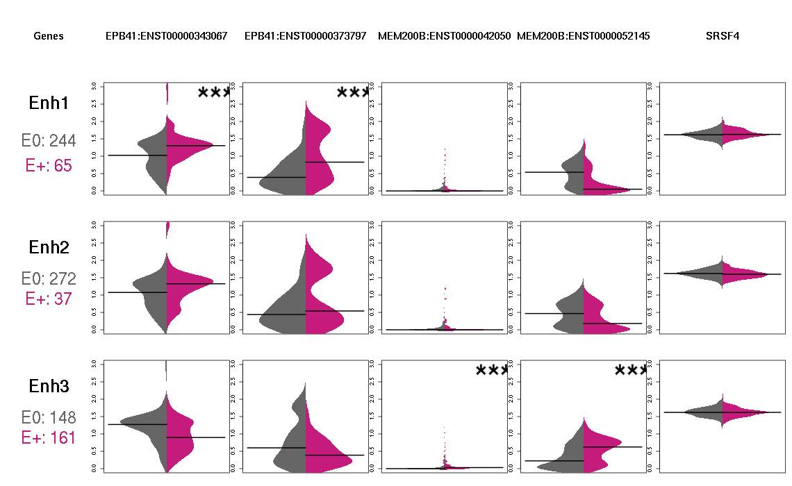

# Description

This notebook is used for making plots needed for the online resource.

# Libraries

```{r Libraries, message=FALSE}

library(org.Hs.eg.db)
library(Gviz)
#library(BSgenome.Hsapiens.UCSC.hg19)
library(tidyverse)

# These are needed for EPplots.R
library(stringr)
library(dplyr)
library(GenomicRanges)
library(RColorBrewer)
library(beanplot)

# Utils based on Anjas functions : expression_matrix_cage_functions.R
source("utils.R")

project_dir <- "/home/katarina/MyProjects/targPred"
inputs_dir <- "data/inputs"
processed_dir <- "data/processed"
outputs_dir <- "data/outputs"
# GWAS catalog in use
gwas_dir <- "gwas_catalog_2021"

```

# Loading data

```{r}
# Object that contains all GRBs, genes, enhancers and empP values for enh-transcript
byGRB_list <- readRDS(file.path(project_dir, processed_dir, "byGRB_list.rds"))

# loci_in_GRBs.df <- read_csv("data/loci_in_GRBs.df.csv",
#                             show_col_types = FALSE)
loci_in_GRBs.df <- readRDS(file.path(project_dir, processed_dir, "loci_in_GRBs.df.rds"))
loci_in_GRBs.gr <- readRDS(file.path(project_dir, processed_dir, "loci_in_GRBs.gr.rds"))
snps_in_GRBs.gr <- readRDS(file.path(project_dir, processed_dir, "snps_in_GRBs.gr.rds"))

# Target genes for CNE density GRBs 
target_genes <- 
  read.csv(file.path(project_dir, inputs_dir, "hg19.canFam3.tsv"), sep = "\t", header = TRUE)  

# Building target gene genomic ranges
target_genes_gr <- grangesFromDataframe(target_genes, ucscCoordinates.hg19)

# Sent by Anja by mail (from fantom5 data)
# enhancers and promoters are pooled data
TSSs.perTranscript.gr <- readRDS(file.path(project_dir, processed_dir, "TSSs.perTranscript.gr.rds"))
fantom5.enhancers.tpm.gr <- readRDS(file.path(project_dir, processed_dir,"fantom5.enhancers.tpm.pooled.gr.rds"))
promoter_cage_tpm_df <- readRDS(file.path(project_dir, processed_dir,"promoter_cage_tpm_df_fixed_pooled.rds"))


# GRBS
grbs <- readRDS(file.path(project_dir, processed_dir, "GRBs_with_targets.gr.rds"))

# list with gene ids (Anja)
genes.hg19.ensembl <- readRDS(file.path(project_dir, processed_dir,"genes.hg19.ensembl.rds"))

gwas_associations <- readRDS(file.path(project_dir, inputs_dir, gwas_dir,"gwas_associations.rds"))

```

# Beanplots

This chunk is based on Anjas code for plotting Enhancer-promoter pairs.
The function used in this chunk is stored in utils.R. This chunk is here
for easier navigation through the pipeline but is run on orthus and with
EPplots.R where all the functions and data needed are listed. The code
plots enhancer promoter pairs per trait and GRB and stores each trait
related plots in respective directories. For each GRB we select
enhancers that overlap the SNP loci (we don't consider all enhancers in
a given GRB). We separate samples based on enhancer activity, if CAGE
peak values of an enhancer is \> 0 the enhancer is considered active. We
differentiate samples with active enhancers and inactive (E+ and E-) and
using non-symetrical violin plot plot the distribution of promoter TPMs.
The magenta (right) side of the plot represent the distribution of
promoter TPMs of samples with active enhancers, and the gray (left) side
of inactive enhancers, respectively. The black lines represent the mean
of the distribution and the significance is calculated by empirical p
value. Example:



```{r EPplots, eval=FALSE}
# Creating directory structure
ep_pair_dir <- file.path(project_dir, outputs_dir, "plots/expression_pairs")

if(!file.exists(ep_pair_dir)){
  dir.create(ep_pair_dir)
}

# for testing one change value in bracket
for (trait in unique(loci_in_GRBs.df$MAPPED_TRAIT)[1]) {
  
  # Generating folder in ep_pair_dir for trait
  trait_dir <- str_replace_all(trait, " ", "_")
  if(!file.exists(file.path(ep_pair_dir,trait_dir))){
    dir.create(file.path(ep_pair_dir,trait_dir))
  }
  
  # Grbs that are relevant for the trait
  trait_grbs <- 
    filter(loci_in_GRBs.df, MAPPED_TRAIT == trait) %>% 
    pull(grb.coords) %>% 
    unique() %>%
    str_replace_all(pattern = ":|-", replacement = "_") 
  
  for(i_grb in trait_grbs){
  # For continuing grbs
  #for(i_grb in trait_grbs[match(i_grb, trait_grbs):length(trait_grbs)]){
      
    # loci_in_GRB for working trait
    i_loci.gr <- loci_in_GRBs.gr[(mcols(loci_in_GRBs.gr)$MAPPED_TRAIT == trait)]
    plotEnhPromBeanPerTrait(byGRB_list, i=i_grb,
                            # loci associated with trait
                            loci.gr = i_loci.gr,
                            neuronal=F, sign="permutation", 
                            dir=file.path(ep_pair_dir,trait_dir),
                            file_suffix= paste0(trait_dir,"_", i_grb, "_gene_expression_beanplot.png"),
                            enhancer_tpm.gr = fantom5.enhancers.tpm.gr,
                            promoter_tpm.df = promoter_cage_tpm_df)
    
  }
}
```


```{r, eval=FALSE}
col_vec <- c("darkgoldenrod1", "darkorange1", "red")

# plot the legend:
l <- c(expression("p">="0.01"), expression("p">="0.001"), expression("p"<="0.001"))
l_title <- "Empirical p-value"
plot_box_legend(l, col_vec, "legend_corrplot_empP.png", l_title, FALSE) # vertical legend
plot_box_legend(l, col_vec, "legend_corrplot_empP_horiz.png", l_title, TRUE) # horizontal legend
```

```{r testing1, eval=FALSE}
df <- byGRB_list[["chr2_29386917_30271314"]][[3]]

df["chr2:29435309-29435425","ENSG00000115295:ENST00000320081"]
```

# Testing

```{r testing2, eval=FALSE}
for (trait in unique(loci_in_GRBs.df$MAPPED_TRAIT)) {
  
  # Generating folder in ep_pair_dir for trait
  trait_dir <- str_replace_all(trait, " ", "_")
  if(!file.exists(file.path(ep_pair_dir,trait_dir))){
    dir.create(file.path(ep_pair_dir,trait_dir))
  }
  
  # Grbs that are relevant for the trait
  trait_grbs <- 
    filter(loci_in_GRBs.df, MAPPED_TRAIT == trait) %>% 
    pull(grb.coords) %>% 
    unique() %>%
    str_replace_all(pattern = ":|-", replacement = "_") 
  
  start_time <- Sys.time()
  
  for(i in 1:length(trait_grbs)){
  # For continuing grbs
  #for(i_grb in trait_grbs[match(i_grb, trait_grbs):length(trait_grbs)]){
      
    # loci_in_GRB for working trait
    i_loci.gr <- loci_in_GRBs.gr[(mcols(loci_in_GRBs.gr)$MAPPED_TRAIT == trait)]
    plots_prom_expression_beanplot_per_locus(byGRB_list, i=i,
                            neuronal=F, sign="permutation", 
                            dir=file.path(ep_pair_dir,trait_dir),
                            file_suffix= paste0(trait_dir,"_", "_gene_expression_beanplot2.png"))
    break
    
  }
  end_time <- Sys.time()
  print(start_time-end_time)
  break
}


```

# Genomic locus
Tested the next chunks localy but ran everything on orthus. Used GvizPlots.R


```{r}
# Creating directory for plots

# Creating directory structure
gviz_dir <- file.path(project_dir, outputs_dir, "plots/gviz_plots")
 
if(!file.exists(gviz_dir)){
   
  dir.create(gviz_dir)
}

# Adding a column to grbs that correspond to targets
grbs$targets <- grbs$geneName

# actual plotting, saved in gviz_dir
loci_in_GRBs.gr$name <- loci_in_GRBs.gr$SNPS # need to have a $name column for gviz plotting


# pretty sure this is not important. transfered this into GWAS_SNPs_inGRB
# genome(loci_in_GRBs.gr) <- genome(BSgenome.Hsapiens.UCSC.hg19)
# seqlevels(loci_in_GRBs.gr) <- seqlevels(BSgenome.Hsapiens.UCSC.hg19)
# seqlengths(loci_in_GRBs.gr) <- seqlengths(BSgenome.Hsapiens.UCSC.hg19)
# gen <- genome(loci_in_GRBs.gr)

# preparing mart to extract gene objects from
library(biomaRt)
mart <- useMart(dataset="hsapiens_gene_ensembl", biomart="ENSEMBL_MART_ENSEMBL", host="https://feb2014.archive.ensembl.org")
```


```{r}
# flagging loci to be treated separately as these contain some exceptions:
# TBR1 locus [10] -> merge 2 GRBs...
#sink("Gviz_Rconsoleoutput.txt")
for(trait in unique(loci_in_GRBs.df$MAPPED_TRAIT)[1]){
  trait_dir <- file.path(gviz_dir,str_replace_all(trait," |/","_"))
  # Creates a dir if it does not exist
  if(!file.exists(trait_dir)){dir.create(trait_dir)}
  #sink(paste(gviz_dir,"/",str_replace_all(trait," |/","_"),"/","Gviz_Rconsoleoutput.txt", sep = ""))
  # to be done on each locus
  message(trait)
  # Including only loci in trait
  loci_in_GRB_trait <- loci_in_GRBs.gr[loci_in_GRBs.gr$MAPPED_TRAIT == trait,]
  # Remoivng duplicated SNPS per trait/locus
  loci_in_GRB_trait <- loci_in_GRB_trait[!duplicated(loci_in_GRB_trait$SNPS),]
  
  grbs_to_loop <-
    which( names(byGRB_list) %in% str_replace_all(loci_in_GRB_trait$grb.coords, pattern = ":|-", replacement = "_"))
  
  #for (i in (1:length(byGRB_list))) {
  for (i in grbs_to_loop) {

    print(paste("Plotting Gviz for", names(byGRB_list)[i], sep=" "))
    tryCatch(locusGviz(i, 
                dir=paste0(trait_dir,"/",str_replace_all(trait," |/","_"),"_"),
                labels=T, 
                byGRB_list=byGRB_list, 
                # Selecting only loci with the trait
                loci.gr= loci_in_GRB_trait, 
                # Selecting only SNPs with the trait
                snps.gr=snps_in_GRBs.gr[snps_in_GRBs.gr$SNPS %in%
                                          loci_in_GRB_trait$SNPS,],
                grbs=grbs, 
                mart=mart,
                trait = trait),
              error=function(e){cat("ERROR :",conditionMessage(e), "\n",
                                    trait, i)})
  }
  #sink()
}

```


Trying to recreate
```{r}

Purple <- "#A74F7C" 
Grey   <- "#7D949B"

current_SNPs <- 
  filter(snps_in_GRBs.gr, is.element(SNPS, c("rs1891058", "rs147340715")))

current_GRB <- subsetByOverlaps(grbs, current_SNPs)


strack <- AnnotationTrack(current_SNPs, name="GWAS SNPs", 
                          stacking="full",
                          group=current_SNPs$SNPS, groupAnnotation="group",
                          fill=Purple, col=Purple)

grbtrack <- AnnotationTrack(current_GRB, name="GRB human:dog", 
                            id=current_GRB$targets, fontcolor.feature="black", 
                            fill=Grey, col=Grey)
displayPars(grbtrack) <- list(featureAnnotation="id")

plotTracks(list(grbtrack, strack),
           sizes = c(1,1),
           background.title="azure3", fontcolor.title="black")
```

# Session Info

```{r Session info}
sessionInfo()
```
